<!-- portrait + neofetch card share an 840x880 canvas, so equal widths give equal heights.
     portrait:  python scripts/make_portrait.py      (only when the photo changes)
     info card: python scripts/make_info_card.py     (edit ROWS when details change) -->

<table>
<tr>
<td valign="top"></td>
<td valign="top"></td>
</tr>
</table>

 

<!-- contribution graph + stats card: real data, redrawn daily by .github/workflows/profile-art.yml -->

 
 

 
 

&nbsp;
&nbsp;
&nbsp;
&nbsp;
&nbsp;
&nbsp;
&nbsp;
&nbsp;
&nbsp;
&nbsp;
&nbsp;
&nbsp;

  
&nbsp;
&nbsp;
&nbsp;
&nbsp;
&nbsp;
&nbsp;
&nbsp;
&nbsp;

 

<b>About me & skills</b>

 

I am a Data Scientist and Co-Founder of Tunga Innovation Limited, with a strong background in data analytics, machine learning, and predictive modeling. My work focuses on building AI-driven platforms that integrate predictive analytics, optimization, and real-time data processing to improve health and agricultural systems in Kenya. I have hands-on experience with LLMs, computer vision, and Apache Spark pipelines. I hold a Master’s in Data Science and Analytics from Strathmore University and am deeply passionate about using AI for social good and empowering disadvantaged communities through innovative solutions.

| Area | Tools |
| --- | --- |
| Programming | Python, SQL, R |
| Machine learning | Predictive modelling, statistical methods, scikit-learn, TensorFlow, Keras |
| GenAI & LLMs | OpenAI GPT, BERT, T5, Hugging Face Transformers |
| Data visualisation | Power BI, Tableau, Matplotlib, Seaborn, Plotly, D3.js, Dash, Shiny for R |
| Big data | Apache Spark, Hadoop |
| Data warehousing | Snowflake, BigQuery, Redshift |
| Data engineering | Apache Airflow, Kafka, ETL tools, SSIS |
| Cloud | AWS (SageMaker, EC2), Azure (ML Studio), Google Cloud (AI Platform) |
| Model deployment | Flask, Streamlit |
| Web | HTML, CSS, JavaScript, React, WordPress |

 

<b>Data Scientist · Co-Founder & CEO, Tunga Innovation · Building AbleSpeak</b>

 

<!-- once snake.yml has run, add a light variant:
     <source media="(prefers-color-scheme: light)" srcset="https://raw.githubusercontent.com/LubangaD/LubangaD/output/snake-light.svg" /> -->

 
 

Art is generated by the Python scripts in <a href="./scripts">scripts/</a> and refreshed daily by GitHub Actions. Terminal style inspired by <a href="https://www.avivashishta.com/blog/build-animated-github-profile-readme">Avi Vashishta</a>.

